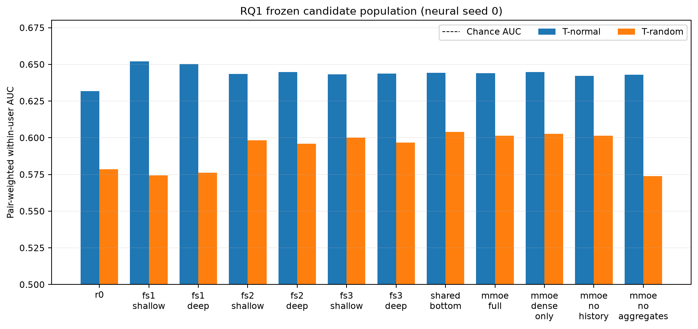
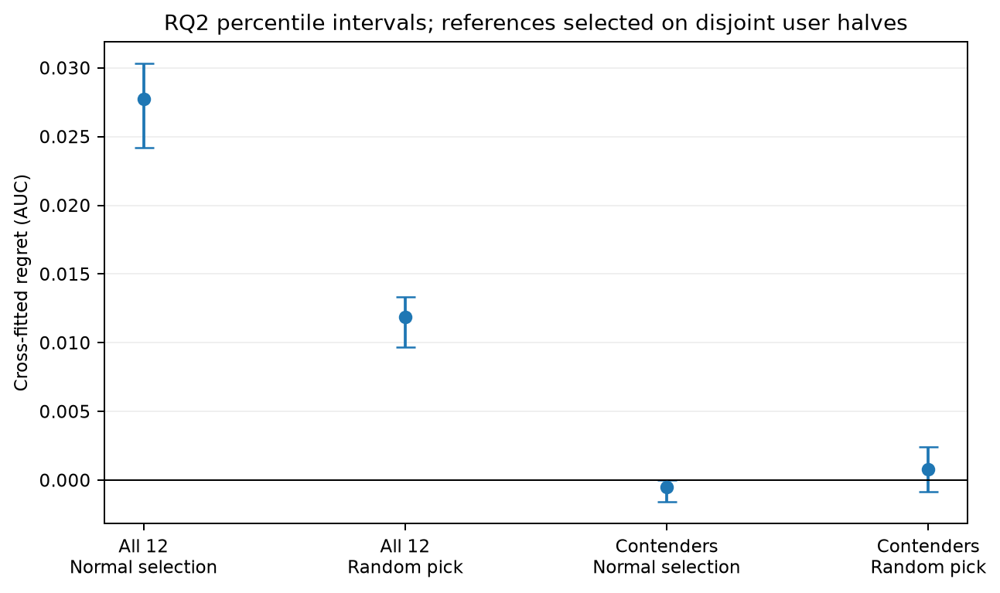
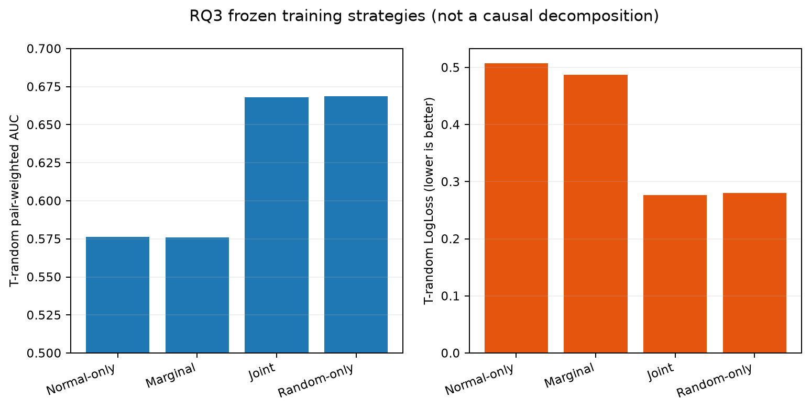

# Feed Ranking Under Exposure Bias: Offline Evaluation and Model Selection on KuaiRand-Pure

Recommendation models are usually trained, selected, and evaluated on logs produced by an existing ranking policy. That feedback loop can make a model look strong because it matches historical exposure—not because it generalizes to less-selected items. This project studies that gap with KuaiRand-Pure normal-policy and randomized-exposure logs, a frozen chronological protocol, 12 predefined ranking configurations, and user-level paired inference.

The repository is a leakage-audited research implementation spanning data acquisition, point-in-time features, LightGBM and multi-task neural models, exposure-aware training, held-out evaluation, cross-fitted model-selection regret, and reproducible publication figures.

## Research questions

- **RQ1 — architecture and representation:** how do popularity, LightGBM, shared-bottom, MMoE, and predefined ablations compare under normal versus randomized exposure?
- **RQ2 — selection regret:** does selecting a workflow on normal-policy validation choose a model that also ranks well under randomized exposure?
- **RQ3 — exposure-aware training:** how do marginal-frequency weighting, normal-plus-random fusion, and randomized-only training compare with the frozen normal-only workflow?

## Headline findings

1. **Model rankings change with exposure policy.** FS1-deep LightGBM was the prospectively selected normal-validation workflow. Its final randomized-exposure AUC was **0.576135**, while several history-based and neural candidates ranked better on T-random.
2. **Selection regret depends on the comparison population.** Across all 12 candidates, cross-fitted normal-selection regret was **+0.027714 AUC**, 95% CI **[0.024180, 0.030318]**. Within the frozen three-candidate contender set, regret was **-0.000527**, CI **[-0.001580, 0]**—a prominent null result.
3. **Access to randomized training examples mattered; marginal weighting did not improve primary AUC.** T-random AUC was **0.576135** for normal-only, **0.667952** for joint training, and **0.668881** for random-only training. Marginal-frequency reweighting produced **0.575991**.

These are offline ranking results. They do not establish causal debiasing, online policy improvement, or business uplift.

## Main figures







The [full research report](reports/final_research_report.md) contains the chronology, all six prespecified comparisons, sensitivity figures, complete metrics, and limitations.

## Dataset and chronological design

The study uses [KuaiRand-Pure](https://github.com/chongminggao/KuaiRand), downloaded from the authors' [Zenodo record](https://zenodo.org/records/10439422). Use only `KuaiRand-Pure.tar.gz`, not KuaiRand-1K or KuaiRand-27K.

| Partition | Dates | Use |
|---|---|---|
| Burn-in | Apr 9–11, 2022 | Feature history only |
| Normal training | Apr 12–29 | Baselines and ordinary candidates |
| Randomized training | Apr 22–29 | RQ3 random-only and joint arms |
| Normal validation | Apr 30–May 2 | Frozen workflow selection |
| T-normal / T-random | May 3–8 | Final held-out evaluation |

Aggregate features use normal-policy events from strictly earlier calendar days. Neural histories use only normal-policy events with timestamps strictly earlier than the target. Randomized outcomes never enter feature history.

The archive MD5 is `0820331067a3784d9691136f772b35a7`. The included archive license is CC BY-SA 4.0, but dataset-specific redistribution scope was not independently confirmed from Zenodo metadata. This repository therefore does not redistribute raw data. See the [data card](docs/data_card.md) for source, schema, randomization, and licensing caveats.

When using the dataset, cite the [KuaiRand paper](https://arxiv.org/abs/2208.08696) and the official dataset release. The Python dependencies are not vendored and remain subject to their respective licenses. Repository code is licensed under [Apache License 2.0](LICENSE); that code license does not grant rights to redistribute KuaiRand-Pure data or other third-party material.

## Features and models

- **FS1:** released static user and basic-video fields plus interface context.
- **FS2:** FS1 plus strictly prior-day normal-policy user/video counts and smoothed task rates.
- **FS3:** FS2 plus user–tag-set affinity and recency. Last-20 histories remain separate neural inputs.
- **R0:** prior-day smoothed video long-view popularity.
- **LightGBM:** FS1/FS2/FS3 × shallow/deep.
- **Shared-bottom MLP:** long-view, like, and tab-1 valid-play heads.
- **MMoE:** four experts, three task gates, and task-specific towers.
- **Ablations:** dense-only, no-history, and no-aggregates.

Neural seed 0 is primary; seeds 1 and 2 are robustness analyses. Tab-1 `is_click` means valid play, while tab-0 means literal click; they are never pooled as one homogeneous target.

## Exposure-aware training

RQ3 freezes FS1-deep and compares normal-only training, inverse smoothed marginal video-frequency weighting, normal plus randomized data fusion with an exposure-source indicator, and randomized-only training. The marginal scheme is a heuristic reweighting rule, not inverse propensity scoring. Joint and random-only arms differ in sample size and source distribution, so their performance differences are not a causal decomposition.

## Evaluation methodology

The primary metric is uncapped pair-weighted within-user long-view AUC with 0.5 credit for score ties. Secondary analyses include equal-user AUC, a frozen 952-pair cap, pooled AUC, LogLoss, and NDCG@5.

RQ2 uses 50 deterministic disjoint user A/B splits in both directions. Candidate selection occurs on one half and evaluation on the other. Confidence intervals use 2,000 paired unique-user bootstrap replicates. Six prespecified RQ1/RQ3 comparisons use 10,000 paired bootstraps and Holm adjustment. A bootstrap tail-share value of zero means no opposite-sign replicate at finite resolution—not an exact p-value of zero.

## Installation

Python 3.11 or newer is required. The completed environment used Python 3.12.7 and CPU-only PyTorch.

Clone the public repository and create an isolated environment:

```bash
git clone https://github.com/boweiye2u/feed-ranking-exposure-bias.git recommendation
cd recommendation
python3 -m venv .venv
source .venv/bin/activate
python -m pip install --upgrade pip
python -m pip install -e '.[dev]'
python scripts/check_environment.py
python -m pytest -q
```

This lightweight code-and-test workflow does not require KuaiRand data or reproduce trained artifacts. Tests that verify the external frozen M6 artifacts run when those artifacts are present and are reported as skipped otherwise.

## Full research reproduction

Download `KuaiRand-Pure.tar.gz` manually from the official Zenodo record, verify it, and extract it so the layout is:

```text
~/recom/raw/KuaiRand-Pure.tar.gz
~/recom/raw/KuaiRand-Pure/data/log_standard_4_08_to_4_21_pure.csv
~/recom/raw/KuaiRand-Pure/data/log_standard_4_22_to_5_08_pure.csv
~/recom/raw/KuaiRand-Pure/data/log_random_4_22_to_5_08_pure.csv
```

Initialize an alternate artifact root if desired:

```bash
export KUAIRAND_ARTIFACT_ROOT=/absolute/path/to/recom
python scripts/init_artifacts.py
md5sum "$KUAIRAND_ARTIFACT_ROOT/raw/KuaiRand-Pure.tar.gz"
python scripts/audit_dataset.py
```

The audit requires the extracted `KuaiRand-Pure/data/` directory and verifies the archive checksum when the archive is present. Use a safe archive extractor and inspect archive members before extraction.

Core entry points, in research order:

```bash
python scripts/engagement_diagnostics.py
python scripts/week0_structural_audit.py
python scripts/build_fs1.py
python scripts/build_fs2.py
python scripts/build_fs3.py
python scripts/review_m2_features.py
python scripts/score_r0.py
python scripts/audit_lightgbm_interface.py
python scripts/train_lightgbm_matrix.py benchmark
python scripts/train_lightgbm_matrix.py full
python scripts/evaluate_normal_validation.py
python scripts/smoke_neural_infrastructure.py
python scripts/train_shared_bottom.py --seed 0
python scripts/train_mmoe.py --seed 0
python scripts/train_mmoe_ablation.py --ablation dense_only --seed 0
python scripts/evaluate_neural_validation.py
python scripts/prepare_rq3_training.py
python scripts/train_rq3_lightgbm.py --arm marginal_reweighting
python scripts/freeze_m5_prefinal.py
python scripts/build_final_predictions.py
python scripts/evaluate_final_rq1_rq3.py
python scripts/evaluate_rq2_regret.py
```

Repeat neural and RQ3 training commands for the seeds/arms fixed in configuration. Full reproduction requires the dataset, approximately 1.4 GiB of local artifact storage for this run, and the frozen protocol permissions. It was executed incrementally in the documented environment; a clean-machine end-to-end rerun has not been claimed. See the [reproducibility guide](docs/reproducibility.md) before running held-out workflows.

## Repository structure

```text
configs/                 Frozen data, feature, model, and evaluation settings
docs/                    Study plan, amendments, data card, and milestone records
reports/                 Final report, compact tables, and publication figures
scripts/                 Audits, feature builds, training, evaluation, packaging
src/kuairand_pure/       Installable Python package
tests/                   Synthetic, leakage, alignment, inference, and docs tests
~/recom/                 External raw/processed/model/prediction/evaluation artifacts
```

## Reproducibility and limitations

- Protocol: [frozen study plan](docs/study_plan_v5.md), [Week-0 amendment](docs/week0_amendment_v1.md), and [statistical amendment](docs/m5_3_statistical_amendment_v1.md).
- Reproduction: [docs/reproducibility.md](docs/reproducibility.md).
- Full findings: [reports/final_research_report.md](reports/final_research_report.md).
- Compact source tables: [reports/tables](reports/tables/).
- Figure provenance: [reports/figures/manifest.json](reports/figures/manifest.json).

Offline evaluation cannot establish online uplift. Randomized insertion does not randomize users, contexts, or every interface, and assignment propensities are unavailable. T-random contains no tab-0 impressions, so literal click is not estimable. Pair-weighted AUC emphasizes active users, which is why equal-user and capped sensitivities are reported.

Large data, processed features, model checkpoints, and predictions are intentionally excluded from Git. Do not commit or redistribute KuaiRand-Pure records or trained artifacts without separately confirming applicable terms.
