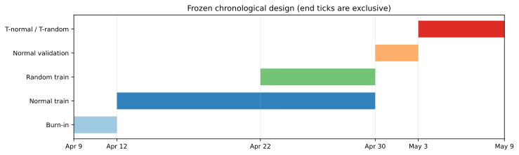
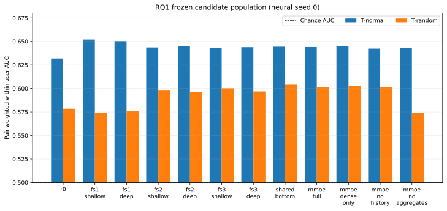
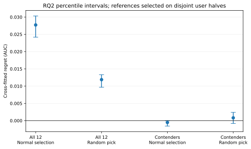
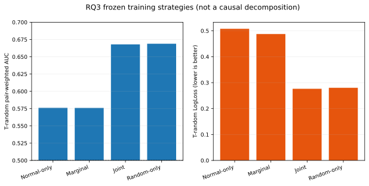
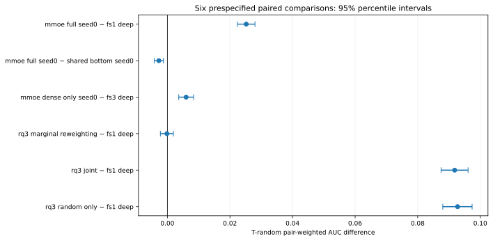
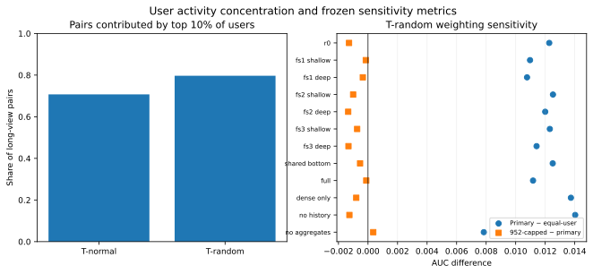

# Feed Ranking under Exposure Bias with KuaiRand-Pure

## Research summary

This study asks how recommendation conclusions change when models trained and selected on ordinary recommendation logs are evaluated under randomized exposure. It addresses three preregistered questions:

1. **RQ1 — architecture and representation:** how do popularity, LightGBM, shared-bottom multi-task learning, MMoE, and predefined ablations rank impressions under normal and randomized exposure?
2. **RQ2 — selection regret:** does choosing a workflow on normal-policy validation select a model that also ranks well under randomized exposure?
3. **RQ3 — exposure-aware training:** do marginal exposure reweighting, normal-plus-random fusion, or randomized-only training improve randomized-exposure ranking relative to the frozen normal-only workflow?

The three main findings are:

- Representation and architecture conclusions depend on exposure policy. FS1 models were strongest among LightGBM candidates on T-normal, while FS2/FS3 and neural models were stronger on T-random. This is an offline distributional result, not evidence of online business uplift.
- Across all 12 candidates, the normal-validation-selected FS1-deep model had cross-fitted randomized-exposure selection regret of **0.027714** (95% percentile CI **[0.024180, 0.030318]**). Within the prospectively frozen three-candidate contender set, regret was **-0.000527** (**[-0.001580, 0]**), so the realistic contender-only analysis did not show a loss.
- Marginal reweighting did not improve primary randomized AUC over normal-only training, whereas joint and random-only training improved it by about 0.092. These comparisons differ in sample size and training-source distribution and are not a causal IPS decomposition.

## Data, policies, and chronological design

KuaiRand-Pure supplies normal-policy and randomized-exposure impression logs plus static user/video metadata. The project uses Branch B1. Raw data remains outside Git and is not redistributed.

- Feature-only burn-in: April 9–11, 2022.
- Normal training: April 12–29.
- RQ3 randomized training: April 22–29.
- Normal validation: April 30–May 2.
- T-normal and T-random: May 3–8.

Point-in-time aggregates use normal-policy outcomes from strictly earlier calendar days. Last-20 histories use only normal-policy impressions with timestamps strictly earlier than the target. Randomized outcomes never enter feature history. Static released video statistics were excluded because their temporal cutoff could not be verified. Final labels remained inaccessible until the authorized M6 evaluation.

## Features and models

- **FS1:** released static user and basic video fields, with tab as context. The exposure-source indicator is excluded except for the RQ3 joint arm.
- **FS2:** FS1 plus strictly prior-day user/video impression counts, task-positive counts, and additive-smoothed rates (`alpha=20`) based on frozen burn-in priors.
- **FS3:** FS2 plus user–complete-tag-set affinity and interpretable recency features. Neural histories are separate fixed-length inputs, not dense FS3 columns.
- **R0:** strictly prior-day smoothed video long-view popularity.
- **LightGBM:** shallow/deep FS1–FS3 candidates with fixed 300-round configurations and training-only categorical vocabularies.
- **Shared-bottom:** three-head MLP for long view, like, and tab-1 valid play.
- **MMoE:** four 64-unit experts, three task gates, and 32-unit towers. Neural models use separate user/video embeddings and masked-mean last-20 video-history embeddings.
- **Ablations:** dense-only, no-history, and no-aggregates; no other post hoc architecture was added.

Neural primary results use seed 0. Seeds 1 and 2 are robustness analyses only. `is_click` is interface-dependent: tab 1 denotes valid play and tab 0 denotes literal click. ESMM was excluded because likes do not require click. T-random contains no tab-0 impressions, so literal click is not estimable there.

## Metrics and inference

The primary metric is uncapped pair-weighted within-user long-view AUC. A positive–negative pair receives concordance 1, 0, or 0.5 for correct, incorrect, or tied scores. Users with one outcome class contribute no pairs. Secondary metrics are equal-user AUC, the frozen 952-pair capped sensitivity, pooled AUC, LogLoss, and NDCG@5.

T-random contains 637,492 long-view impressions from 26,186 users; 14,805 users contribute 2,840,873 positive–negative pairs. The top 10% of users contribute 79.68% of pairs, motivating the capped and equal-user sensitivity analyses.

## RQ1: frozen candidate comparison

| Candidate | T-normal primary AUC | T-random primary AUC |
|---|---:|---:|
| R0 | 0.631755 | 0.578477 |
| FS1 shallow | 0.652015 | 0.574344 |
| FS1 deep | 0.650272 | 0.576135 |
| FS2 shallow | 0.643495 | 0.598350 |
| FS2 deep | 0.644768 | 0.595867 |
| FS3 shallow | 0.643172 | 0.600146 |
| FS3 deep | 0.643810 | 0.596792 |
| Shared-bottom | 0.644336 | 0.604043 |
| Full MMoE | 0.643991 | 0.601330 |
| MMoE dense-only | 0.644682 | 0.602779 |
| MMoE no-history | 0.642289 | 0.601447 |
| MMoE no-aggregates | 0.642856 | 0.573903 |

FS1-deep remains the prospectively selected workflow because selection occurred on normal validation. Shared-bottom seed 0 has the highest retrospective point estimate on T-random, but it is not substituted as the workflow selection. Removing aggregate features produces the clearest MMoE degradation under randomized exposure. Differences between T-normal and T-random are not causal treatment effects.

## RQ2: cross-fitted selection regret

The randomized reference is selected on one unique-user half and evaluated on the disjoint half, then directions are swapped across 50 deterministic splits. Candidate selection is recomputed within each of 2,000 paired user bootstraps. It is a cross-fitted reference, not a retrospective oracle or an online policy.

| Population | Reference AUC | FS1-deep AUC | Normal-selection regret (95% CI) | Random-pick regret (95% CI) |
|---|---:|---:|---:|---:|
| All 12 | 0.603866 | 0.576152 | 0.027714 [0.024180, 0.030318] | 0.011881 [0.009673, 0.013311] |
| Frozen contenders | 0.575625 | 0.576152 | -0.000527 [-0.001580, 0] | 0.000815 [-0.000817, 0.002402] |

The all-candidate reference selected shared-bottom on 93 of 100 halves and dense-only MMoE on 7. The contender reference selected FS1-deep on 90 halves and MMoE no-aggregates on 10. The contender-only null result is central: the broader configuration population reveals exposure-dependent selection regret, while the subset that was plausibly competitive on normal validation does not. Random-pick regret is a descriptive preregistered benchmark, not an additional significance claim.

## RQ3: exposure-aware training

| Arm | Training rows | T-random AUC | Difference vs normal-only | LogLoss |
|---|---:|---:|---:|---:|
| Normal-only FS1-deep | 722,481 | 0.576135 | — | 0.507577 |
| Marginal reweighting | 722,481 | 0.575991 | -0.000145 | 0.487366 |
| Normal + random fusion | 1,060,414 | 0.667952 | +0.091817 | 0.276344 |
| Random-only | 337,933 | 0.668881 | +0.092746 | 0.280162 |

The marginal weights have ESS 152,212.85 (21.07%). This heuristic uses inverse smoothed marginal video frequency and is explicitly not causal inverse-propensity scoring. Joint and random-only fits use different data sizes and source distributions; their gains cannot be attributed solely to random exposure.

## Prespecified paired comparisons

| Left minus right | Difference | 95% percentile CI | Tail-share p | Holm p |
|---|---:|---:|---:|---:|
| Full MMoE − FS1-deep | 0.025195 | [0.022390, 0.027997] | 0 | 0 |
| Full MMoE − shared-bottom | -0.002713 | [-0.004158, -0.001263] | 0.0002 | 0.0004 |
| Dense-only MMoE − FS3-deep | 0.005987 | [0.003629, 0.008376] | 0 | 0 |
| Marginal − FS1-deep | -0.000145 | [-0.002236, 0.001917] | 0.8840 | 0.8840 |
| Joint − FS1-deep | 0.091817 | [0.087470, 0.096109] | 0 | 0 |
| Random-only − FS1-deep | 0.092746 | [0.088016, 0.097389] | 0 | 0 |

The six tests use 10,000 paired unique-user bootstraps and standard step-down Holm adjustment. A displayed tail-share value of zero means no opposite-sign replicate among 10,000 draws; it is a finite-resolution estimate, not an exact p-value of zero. The tail-share bootstrap is a pragmatic descriptive approximation rather than a rigorously null-centered test.

## Pair concentration and sensitivity

Primary, capped, and equal-user AUCs are reported together because pair weighting emphasizes high-activity users. The cap changes T-random AUCs modestly; equal-user estimates are generally lower. Neither sensitivity replaces the frozen primary metric.

## Limitations

- Offline ranking metrics do not measure online engagement or business uplift.
- Random exposure improves evaluation coverage but does not make architecture comparisons causal.
- RQ3 training arms differ in examples and source distributions.
- The random held-out window is one six-day period.
- Long-view definitions and opaque released categorical codes remain constrained by dataset documentation.
- T-random literal click cannot be evaluated because the random interface contains no tab-0 impressions.
- Pair-weighted results are sensitive to heavy users, although capped and equal-user analyses provide prespecified checks.

## Reproducibility and artifact policy

The final environment used Python 3.12.7 with NumPy 2.5.3, Polars 2.0.0, PyArrow 26.0.0, pandas 3.0.6, scikit-learn 1.9.1, LightGBM 4.7.0, CPU-only PyTorch 2.14.1, Matplotlib 3.11.2, and pytest 9.1.1. The host exposed two AMD EPYC 7573X sockets, 64 physical cores, and 128 logical CPUs. Production LightGBM training was deterministic and single-threaded; neural training used fixed seeds 0–2 and CPU execution in this environment.

Entry points are documented in the repository README and milestone documents. Configuration and seeds live in `configs/`; frozen checkpoints are `week0-protocol-v1`, `m2-features-v1`, `m4-candidates-v1`, and `m5-prefinal-v1`. M7.1 verifies the M6.1 manifest, every prediction checksum, M6.2/M6.3 output hashes, candidate/contender identities, RQ3 arms, and the six comparison definitions before producing tables or figures.

Raw KuaiRand-Pure data, processed Parquet files, predictions, vocabularies, and model checkpoints remain under `~/recom/` and are intentionally excluded from Git. The repository contains only code, configurations, compact aggregate result tables, documentation, and reasonable-sized vector/PNG figures. The dataset and trained models are not redistributed.

The exact compact tables used for this report are in `reports/tables/`; figure hashes and source-result hashes are in `reports/figures/manifest.json`.
